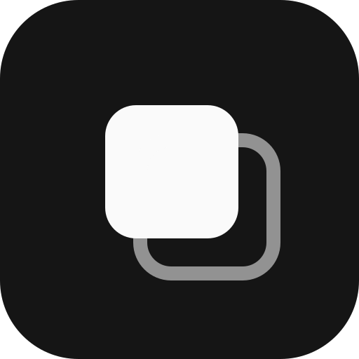
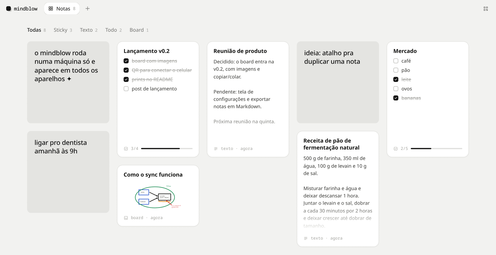
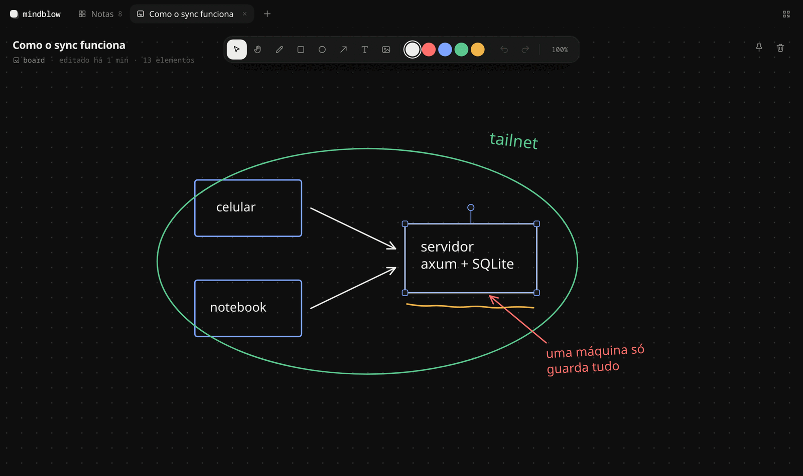
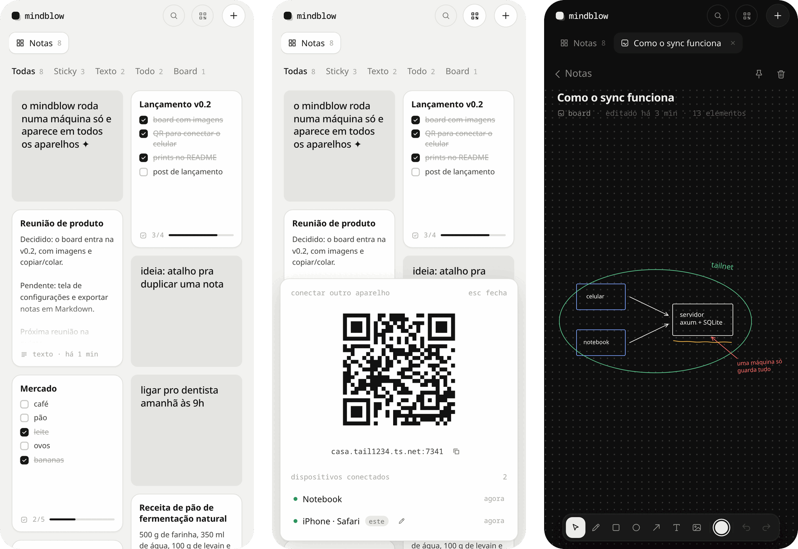

<p align="center">
  
</p>

<h1 align="center">mindblow</h1>

<p align="center">Notas minimalistas que moram numa máquina só e aparecem em todos os seus dispositivos pela tailnet.</p>

<p align="center">
  <picture>
    <source media="(prefers-color-scheme: dark)" srcset="docs/images/grid-dark.png">
    
  </picture>
</p>

Há quatro tipos de nota: **sticky**, **texto**, **todo** e **board**. Elas ficam num grid em que dá para arrastar os cards, abrem em abas e qualquer uma pode virar uma janela própria. Outros apps criam, mudam e tiram notas pela API.

Por baixo: servidor em Rust (axum + SQLite), interface em Svelte 5 e app desktop em Tauri 2.

## Board

Um quadro branco simples: caneta, formas, setas, texto e imagens. Dá para selecionar vários, redimensionar, girar, copiar e colar (inclusive imagem com Ctrl+V).

<p align="center">
  
</p>

## No celular

Abra o link da tailnet e use "adicionar à tela inicial". Para conectar outro aparelho, o botão de QR no canto de cima mostra o código e quem está conectado agora.

<p align="center">
  
</p>

## Instalar

```sh
./deploy/install.sh      # compila, sobe o serviço e publica na tailnet; no fim imprime o link
cargo run -p mindblow-app --release   # janela desktop, abre o servidor local
```

## Desenvolver

```sh
cargo run -p server      # API em :7341
cd web && pnpm dev       # interface em :5341, com proxy para a API
cargo test && (cd web && pnpm test && pnpm check)
```

## Docs

- [Arquitetura](docs/architecture.md)
- [API](docs/api.md)
- [Deploy e configuração](docs/deploy.md)

## Licença

[MIT](LICENSE)
